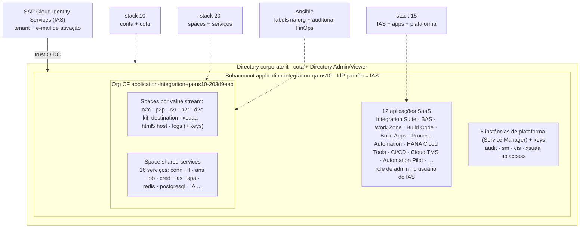

# SAP BTP com Terraform + Ansible

Exemplo didático, pronto para rodar numa conta **trial** do SAP BTP, de como
montar uma *landing zone* com governança desde o primeiro recurso:

- **Convenção de nomes** no estilo Azure CAF: `application-integration-qa-us10`
- **Labels de FinOps** em directory, subaccount, spaces, instâncias e service keys,
  incluindo `value-stream` para ver o custo por processo de negócio
- **Identidade de ponta a ponta**: tenant do SAP Cloud Identity Services (IAS)
  com e-mail de ativação, trust no subaccount, IAS como IdP padrão e SAP ID
  service fora do login das aplicações
- **Permissões por persona** no directory, no subaccount, na org e em cada space,
  e a role de admin de cada aplicação no usuário do IAS assim que ela é assinada
- **Todas as aplicações e serviços que a trial permite**: Integration Suite, BAS,
  Work Zone, Build Code, Build Apps, Process Automation, HANA Cloud Tools e
  outras; ~40 instâncias com service keys por consumidor

O **Terraform** cria tudo isso. O **Ansible** cobre o que o Terraform não alcança
(labels na org, que é criada pelo BTP) e audita o ambiente real contra a
política de labels.

## O que é criado



| Camada | Ferramenta | Cria/gerencia |
| --- | --- | --- |
| Stack `10-btp-account` | Terraform `SAP/btp` | Directory (cota + permissões), subaccount, catálogo de entitlements, papéis de plataforma, ambiente CF (org) |
| Stack `15-btp-services` | Terraform `SAP/btp` | IAS (onboarding + trust), IAS como IdP padrão, `sap.default` fora do login, assinaturas + roles de admin no usuário do IAS, instâncias de plataforma |
| Stack `20-cloudfoundry` | Terraform `cloudfoundry/cloudfoundry` | Papéis na org, spaces por value stream, papéis nos spaces, instâncias e service keys |
| `playbooks/site.yml` | Ansible | Labels e annotations na org; auditoria de labels com inventário CSV |
| Ativação das capabilities do Integration Suite | **Manual** (sem API pública) | Cloud Integration, API Management e Developer Portal |

As camadas se falam só por **outputs** (o contrato entre elas). Detalhes em
[docs/03 (governança e identidade)](docs/03-governanca.md), [docs/04 (Terraform)](docs/04-terraform-boas-praticas.md)
e [docs/05 (Ansible)](docs/05-ansible-boas-praticas.md).

## Estrutura

```text
.
├── Makefile                      # todos os comandos do dia a dia (make help)
├── terraform/
│   ├── modules/                  # blocos reutilizáveis, cada um com testes (terraform test)
│   │   ├── naming/               # convenção de nomes (módulo puro, sem provider)
│   │   ├── finops-labels/        # taxonomia de labels nos formatos BTP e CF (módulo puro)
│   │   ├── btp-directory/        # directory + cota + Directory Admin/Viewer
│   │   ├── btp-subaccount/       # subaccount + entitlements + role collections
│   │   ├── btp-identity/         # onboarding do IAS + trust + IAS como IdP padrão
│   │   ├── btp-apps/             # assinaturas + role collections no usuário do IAS
│   │   ├── btp-services/         # instâncias e service keys no subaccount (Service Manager)
│   │   ├── btp-cloudfoundry/     # ambiente CF (org) e endpoint da API
│   │   ├── cf-org-access/        # papéis na org (membros primeiro)
│   │   └── cf-space/             # space + papéis + instâncias + service keys
│   └── stacks/                   # root modules: um estado por camada
│       ├── 10-btp-account/
│       ├── 15-btp-services/
│       └── 20-cloudfoundry/
├── ansible/
│   ├── playbooks/site.yml        # preflight -> contexto -> login CF -> labels na org -> auditoria
│   └── roles/                    # preflight, btp_context, cf_target, cf_org_metadata, finops_compliance
├── docs/                         # guias (trial, autenticação, governança, boas práticas...)
└── .github/workflows/ci.yml      # fmt, validate, test, tflint, ansible-lint, trivy
```

## Pré-requisitos

- Conta trial do SAP BTP: <https://account.hanatrial.ondemand.com>
- `terraform` 1.9 ou superior, `btp` CLI, `cf` CLI v8, `uv`
- Acesso de rede aos hosts de [docs/01](docs/01-pre-requisitos-trial.md#hosts-que-precisam-estar-liberados)

```bash
brew install hashicorp/tap/terraform cloudfoundry/tap/cf-cli@8 uv
brew install --cask btp            # ou baixe em https://tools.hana.ondemand.com/#cloud-btpcli
```

Não é preciso liberar memória do Cloud Foundry: não há apps. Todos os planos
usados são ELASTIC/APPLICATION da trial, sem cota numérica.

## Passo a passo

```bash
make setup     # .venv com Ansible e linters, tflint, coleções; cria os terraform.tfvars
```

Edite `terraform/stacks/10-btp-account/terraform.tfvars`: `globalaccount`
(subdomínio, veja `btp --info`), nomes, `finops` e `access`.

Exporte as credenciais (usuário e senha do SAP ID service). A senha nunca vai
para arquivo ([detalhes](docs/02-autenticacao.md)):

```bash
export BTP_USERNAME="voce@exemplo.com"
read -rs BTP_PASSWORD && export BTP_PASSWORD   # digitação oculta
```

```bash
make account-plan      # revise: directory, subaccount, entitlements, papéis, org
make account-apply
make services-plan     # revise: IAS, trust, IdP padrão, assinaturas, roles, instâncias de plataforma
make services-apply    # chega o e-mail de ativação do IAS: ative a conta antes de abrir as apps
make cf-plan           # revise: papéis de org e space, spaces por value stream, instâncias, keys
make cf-apply
make configure-check   # dry-run do Ansible
make configure         # labels na org + auditoria (gera .build/finops/cf-inventory.csv)
```

O resultado da auditoria termina assim:

```text
TASK [finops_compliance : Show the compliance summary]
ok: [localhost] => msg: 71 recursos auditados, 0 sem labels obrigatórias.
```

Depois, ative no Integration Suite as capabilities **Cloud Integration** e
**API Management** (com Developer Portal), entrando com o usuário do IAS.

Para desmontar (stacks 20, 15 e 10, nessa ordem):

```bash
make down
```

## Qualidade

Nenhum destes comandos precisa de credenciais:

```bash
make check                       # lint + validate + test (o mesmo que o CI)
.venv/bin/pre-commit install     # roda as checagens a cada commit
```

| Ferramenta | O que garante |
| --- | --- |
| `terraform test` + `mock_provider` | 37 testes da lógica dos módulos (nomes, labels, RBAC, chaves de `for_each`) sem tocar no BTP |
| `tflint` (preset `all`) | Variáveis tipadas e documentadas, versões declaradas, nada sem uso |
| `ansible-lint` (perfil `production`) | FQCN, `changed_when`, prefixo de variáveis por role, permissões |
| `trivy config` | Misconfiguração e segredos versionados |
| `gitleaks` (pre-commit) | Bloqueia commit de senha ou token |

## Documentação

1. [Pré-requisitos da conta trial e rede](docs/01-pre-requisitos-trial.md)
2. [Autenticação: usuário/senha, alternativas e CI/CD](docs/02-autenticacao.md)
3. [Governança: nomes, labels de FinOps, identidade e permissões](docs/03-governanca.md)
4. [Boas práticas de Terraform aplicadas aqui](docs/04-terraform-boas-praticas.md)
5. [Boas práticas de Ansible aplicadas aqui](docs/05-ansible-boas-praticas.md)
6. [Troubleshooting](docs/06-troubleshooting.md)

## O que mudou em relação à versão anterior

A primeira versão deste repositório tinha os módulos `0-directories` a
`5-services` num único root module. Os problemas dela viraram lições:

| Antes | Problema | Agora |
| --- | --- | --- |
| Nomes fixos (`APP_DEV_RPA`, `app-dev-rpa`) | Sem padrão, sem região, colisão de subdomínio entre clientes | Módulo `naming` (CAF) com sufixo único e estável |
| `created_at = [timestamp()]` nas labels | `timestamp()` muda a cada execução: todo `plan` mostrava alteração (drift falso) | Taxonomia de FinOps estável num módulo único |
| Providers BTP e CF no mesmo root module | O provider CF precisa do endpoint de uma org que ainda não existe no primeiro `plan` | Dois stacks, ligados por outputs |
| `SAP/cloudfoundry` `1.0.0-rc1` | Release candidate de um nome de provider abandonado | `cloudfoundry/cloudfoundry ~> 1.18` (oficial) |
| Versões exatas em todos os módulos (`= 1.10.0`) | Módulos travavam upgrades; o root não tinha lock file | Módulos com `>=`, stacks com `~>` e `.terraform.lock.hcl` versionado |
| `depends_on` entre módulos | Adia todos os data sources para o apply e esconde a dependência real | Dependência propagada pelo próprio output (`depends_on` no output) |
| Um único admin, papel por papel | Sem modelo de acesso | Personas aplicadas em directory, subaccount, org e space |
| Senha do CF como variável Terraform | Segredo em tfvars, no histórico do shell e possivelmente no estado | Credenciais só por variáveis de ambiente |
| Sem testes, sem lint, sem CI | — | `terraform test`, tflint, ansible-lint, trivy, pre-commit e GitHub Actions |
