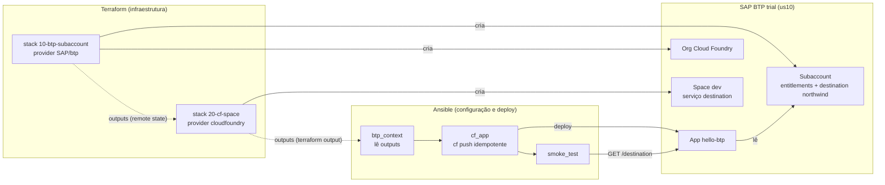

# SAP BTP com Terraform + Ansible

Exemplo didático, pronto para rodar numa conta **trial** do SAP BTP, que mostra
como dividir o trabalho entre as duas ferramentas:

- **Terraform** cria a plataforma (subaccount, entitlements, destination, org e
  space Cloud Foundry, instâncias de serviço).
- **Ansible** configura e implanta o que roda nela (deploy idempotente de uma app
  e um smoke test ponta a ponta).

No fim, uma app Node.js no Cloud Foundry lê uma *destination* que o Terraform
criou, o que comprova que as duas camadas estão ligadas.

## Arquitetura



### Quem faz o quê, e por quê

| Responsabilidade | Ferramenta | Motivo |
| --- | --- | --- |
| Subaccount, entitlements, role collections, destination | Terraform (`SAP/btp`) | Recursos declarativos, com estado, plan e detecção de drift |
| Org Cloud Foundry (ambiente) | Terraform (`SAP/btp`) | É um recurso do BTP, não do Cloud Foundry |
| Space, papéis, instâncias de serviço | Terraform (`cloudfoundry/cloudfoundry`) | Ainda é plataforma; tem provider oficial |
| Deploy da app, variáveis, rotas | Ansible | Muda a cada release, envolve build e ordem de passos |
| Smoke test pós-deploy | Ansible | Verificação procedural, sem estado a guardar |

A regra usada: **o que tem ciclo de vida de infraestrutura e provider declarativo
vai para o Terraform; o que é procedural ou muda a cada release vai para o Ansible.**
As camadas se comunicam só por *outputs*, que funcionam como contrato entre elas.
Os detalhes estão em [docs/03](docs/03-terraform-boas-praticas.md) e [docs/04](docs/04-ansible-boas-praticas.md).

## Estrutura

```text
.
├── Makefile                     # todos os comandos do dia a dia (make help)
├── terraform/
│   ├── modules/                 # blocos reutilizáveis, testados com providers mockados
│   │   ├── btp-subaccount/      # subaccount + entitlements + destinations + admins
│   │   ├── btp-cloudfoundry/    # ambiente CF (org) e extração do endpoint da API
│   │   └── cf-space/            # space + papéis + instâncias de serviço
│   └── stacks/                  # root modules: um estado por camada
│       ├── 10-btp-subaccount/   # provider SAP/btp
│       └── 20-cf-space/         # provider cloudfoundry (lê outputs do 10)
├── ansible/
│   ├── playbooks/site.yml       # preflight -> contexto -> target -> deploy -> smoke test
│   ├── playbooks/teardown.yml   # remove o que o Ansible criou
│   └── roles/                   # preflight, btp_context, cf_target, cf_app, smoke_test
├── app/hello-btp/               # app Node.js sem dependências
├── scripts/install-tflint.sh    # instala tflint fixado, com verificação de checksum
├── docs/                        # guias (pré-requisitos, autenticação, boas práticas...)
└── .github/workflows/ci.yml     # fmt, validate, test, tflint, ansible-lint, trivy
```

## Pré-requisitos

- Conta trial do SAP BTP: <https://account.hanatrial.ondemand.com>
- `terraform` 1.9 ou superior, `btp` CLI, `cf` CLI v8, `uv`, `node` 22 (opcional, para rodar a app localmente)
- **1 GB de memória Cloud Foundry livre** no global account. Na trial, toda a cota
  vem atribuída ao subaccount `trial`, então é preciso liberar 1 GB antes
  ([como fazer](docs/01-pre-requisitos-trial.md#liberar-memória-cloud-foundry)).
- Acesso de rede aos hosts listados em [docs/01](docs/01-pre-requisitos-trial.md#hosts-que-precisam-estar-liberados).

```bash
brew install hashicorp/tap/terraform cloudfoundry/tap/cf-cli@8 uv
brew install --cask btp            # ou baixe em https://tools.hana.ondemand.com/#cloud-btpcli
```

## Passo a passo

```bash
make setup                       # .venv com Ansible e linters, tflint e coleções; cria os terraform.tfvars
```

Edite `terraform/stacks/10-btp-subaccount/terraform.tfvars` e informe `globalaccount`
(o subdomínio, visível em `btp --info`) e `admins` (seu e-mail).

```bash
make login-btp                   # login no navegador (funciona com SAP Universal ID)
make discover                    # (opcional) confira subaccounts e entitlements livres
make account-plan                # revise o plano
make account-apply               # cria subaccount, entitlements, destination e org CF
make login-cf                    # login no CF da nova org (código temporário no navegador)
make space-plan
make space-apply                 # cria space, papéis e o serviço destination
make deploy-check                # dry-run do Ansible
make deploy                      # deploy + smoke test
```

O último passo termina com algo como:

```text
TASK [smoke_test : Ensure the app resolved the destination created by Terraform]
ok: [localhost] => OK: northwind -> https://services.odata.org/V4/Northwind/Northwind.svc
```

Rode `make deploy` de novo: o Ansible detecta que nada mudou e **não** refaz o
push (`changed=0`). Altere `app/hello-btp/server.js` e rode outra vez: só então
acontece um deploy *rolling*, sem downtime.

Para desmontar, na ordem inversa:

```bash
make down
```

## Qualidade

Nenhum destes comandos precisa de credenciais:

```bash
make check                       # lint + validate + test (o mesmo que o CI)
.venv/bin/pre-commit install     # roda as checagens a cada commit
```

| Ferramenta | O que garante |
| --- | --- |
| `terraform test` + `mock_provider` | Lógica dos módulos (chaves de `for_each`, validações, parsing) sem tocar no BTP |
| `tflint` (preset `all`) | Variáveis tipadas e documentadas, versões declaradas, nada sem uso |
| `ansible-lint` (perfil `production`) | FQCN, `changed_when`, prefixo de variáveis por role, permissões |
| `trivy config` | Misconfiguração e segredos versionados |
| `gitleaks` (pre-commit) | Bloqueia commit de senha ou token |

## Documentação

1. [Pré-requisitos da conta trial e rede](docs/01-pre-requisitos-trial.md)
2. [Autenticação: Universal ID, SSO e CI/CD](docs/02-autenticacao.md)
3. [Boas práticas de Terraform aplicadas aqui](docs/03-terraform-boas-praticas.md)
4. [Boas práticas de Ansible aplicadas aqui](docs/04-ansible-boas-praticas.md)
5. [Troubleshooting](docs/05-troubleshooting.md)

## O que mudou em relação à versão anterior

A primeira versão deste repositório tinha os módulos `0-directories` a
`5-services` num único root module. Os problemas dela viraram lições:

| Antes | Problema | Agora |
| --- | --- | --- |
| `created_at = [timestamp()]` nas labels | `timestamp()` muda a cada execução, então todo `plan` mostrava alteração (drift falso) | Labels estáveis (`managed-by`, `project`, `stage`) |
| Providers BTP e CF no mesmo root module | O provider CF precisa do endpoint de uma org que ainda não existe no primeiro `plan` | Dois stacks, ligados por outputs |
| `SAP/cloudfoundry` `1.0.0-rc1` | Release candidate de um nome de provider abandonado | `cloudfoundry/cloudfoundry ~> 1.18` (oficial) |
| Versões exatas em todos os módulos (`= 1.10.0`) | Módulos travavam upgrades; o root não tinha lock file | Módulos com `>=`, stacks com `~>` e `.terraform.lock.hcl` versionado |
| `depends_on` entre módulos | Adia todos os data sources para o apply e esconde a dependência real | Dependência propagada pelo próprio output (`depends_on` no output) |
| Variáveis sem tipo, recebendo o objeto inteiro (`var.subaccount.id`) | Acoplamento e erros só em tempo de apply | Tipos explícitos, `validation` e só os IDs necessários |
| Senha do CF como variável Terraform | Segredo em tfvars, histórico do shell e possivelmente no estado | Sessão SSO dos CLIs, nada de senha no código |
| Recursos em `resource "x" "app_dev_rpa"` fixos | Para cada item novo, era preciso copiar e colar | `for_each` com chaves estáveis a partir de listas e mapas |
| Sem testes, sem lint, sem CI | — | `terraform test`, tflint, ansible-lint, trivy, pre-commit e GitHub Actions |
